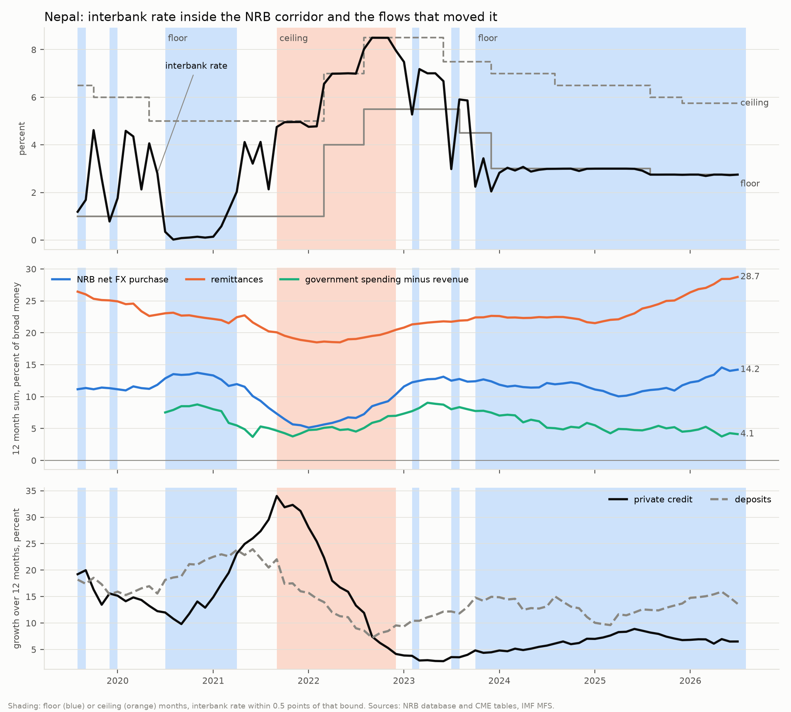

# Nepal: why the interbank rate sat at the floor and at the ceiling, 2019 to 2026

Decision D049. A description, not a forecast or a test. Source: src/econometrics/nepal_liquidity_regimes.py,
reports/tables/nepal_liquidity_regimes.csv, nepal_liquidity_fiscal_years.csv and
reports/figures/nepal_liquidity_regimes.png. Data: NRB Database on Nepalese Economy and Current
Macroeconomic Situation tables (D046), IMF monetary statistics.

## How months are classified

A month is a floor month when the interbank rate is less than half a point above the corridor
floor, a ceiling month when it is less than half a point below the ceiling (the bank rate), and
inside otherwise. The rule was fixed before the flows were examined (as in D041). Flows are
monthly amounts in percent of broad money at the end of the previous month; growth rates are
over twelve months.

Three long episodes stand out; the remaining episodes last one to six months and are shown in
the table file.

| Episode | Months | Interbank rate | NRB net FX purchase | Remittances | Government spending minus revenue | Private credit growth | Deposit growth | Excess reserves, percent of deposits | Months with NRB absorbing on net |
|---|---|---|---|---|---|---|---|---|---|
| Floor, mid July 2020 to mid March 2021 | 9 | 0.31 | 0.93 | 1.88 | 0.17 | 13.7 | 20.9 | 3.61 | 67 percent |
| Ceiling, mid September 2021 to mid November 2022 | 15 | 6.48 | 0.67 | 1.64 | 0.51 | 20.0 | 12.9 | 0.35 | 0 percent |
| Floor, mid October 2023 to mid July 2026 | 34 | 2.86 | 1.05 | 2.09 | 0.42 | 6.5 | 13.3 | 0.71 | 94 percent |

Flows are monthly averages in percent of broad money; growth rates and the excess reserve ratio
are averages of monthly values.

By fiscal year (flows summed over the year, percent of broad money):

| Fiscal year | NRB net FX purchase | Remittances | Government spending minus revenue | Private credit growth | Deposit growth | Floor months | Ceiling months |
|---|---|---|---|---|---|---|---|
| 2019/20 | 12.9 | 23.1 | 7.5 | 15.0 | 16.8 | 3 | 0 |
| 2020/21 | 9.3 | 20.9 | 5.3 | 17.7 | 21.9 | 8 | 0 |
| 2021/22 | 6.7 | 19.0 | 4.5 | 24.9 | 15.1 | 0 | 11 |
| 2022/23 | 12.5 | 21.7 | 8.0 | 4.8 | 9.9 | 2 | 4 |
| 2023/24 | 12.1 | 22.4 | 5.1 | 4.8 | 13.7 | 10 | 0 |
| 2024/25 | 10.8 | 23.8 | 4.7 | 7.3 | 11.9 | 12 | 0 |
| 2025/26 | 14.2 | 28.7 | 4.1 | 7.0 | 14.1 | 12 | 0 |

## Economic reading

**The mechanism.** Under the peg at 1.6 rupees per Indian rupee, the NRB buys the foreign
currency that remittances and other inflows bring in and pays for it with new rupee reserves.
Those reserves are lent on through the interbank market. Whether the interbank rate rises or
falls inside the corridor therefore depends on two things: how much reserve money the balance of
payments creates, and how much of it banks need to support new lending. The corridor bounds the
result, and the NRB absorbs or injects at the bounds.

**The 2021/22 ceiling was a credit boom, not a shortage of inflows alone.** Private credit grew
by 34 percent over the year to mid September 2021 and averaged 20 percent through the episode,
against deposit growth of 13 percent. At the same time the import surge that followed the
pandemic cut NRB net FX purchases to 6.7 percent of broad money in 2021/22, the lowest of the
seven years, and remittances slipped to 19 percent. Banks lent faster than deposits came in,
excess reserves fell to a third of a percent of deposits, the NRB never absorbed on net and
instead injected through its standing liquidity facility, and the interbank rate was pushed to
the ceiling and held there as the NRB raised the corridor in 2022.

**The 2023 to 2026 floor was weak credit demand meeting record inflows.** Credit growth
collapsed to about 3 percent in 2023 and has stayed between 5 and 9 percent since 2024, while deposits grew
10 to 16 percent. Remittances rose from 22 percent of broad money in 2023/24 to 29 percent in
2025/26, and NRB net FX purchases rose to 14 percent. The reserves those purchases created had
no lending to absorb them, so the NRB absorbed on net in 94 percent of the months, mainly through
its standing deposit facility, and the interbank rate sat at the floor for 34 consecutive
months. The rate moved only when the NRB lowered the floor itself, from 3.0 to 2.75 percent.

**The fiscal channel did not cause the floor.** Government spending in excess of revenue
injected less liquidity during the long floor episode (4.1 to 5.1 percent of broad money a year)
than in 2019/20 or 2022/23. Slow government spending kept money in the treasury account at the
NRB, which drains reserves. The floor happened despite the fiscal stance, not because of it. An
earlier working note in this project suggested otherwise; the data do not support it.

**The 2020/21 floor was a pandemic episode.** Deposits grew 21 percent while credit demand
stalled, and excess reserves reached 3.6 percent of deposits, the highest in the window. The
interbank rate fell to about 0.1 percent, below the 1 percent deposit collection rate used as the
floor. Before the standing deposit facility was introduced in 2022 the floor was not a facility
open to every bank at all times, so it did not hold as a hard bound.

## What this means for the forecasting results

The frozen binary model (D039) answers the rise question better than the fall question on
2021 to 2026 (balanced accuracy 0.67 against 0.53). This account explains why. A rise needs a
credit boom or a fall in inflows, both visible in monthly data months ahead. A fall of more than
half a point is impossible once the rate is at the floor, unless the NRB moves the floor itself,
which is a policy decision rather than a liquidity outcome. From late 2023 the fall question
became, in effect, a question about NRB floor cuts.

It also explains why the direct flow measures added little in D044 and D047. The model already
knows where the rate sits in the corridor and the gap between credit and deposit growth. Those
two variables summarise what the flows did, so the flows add little of their own over a three
month horizon.

For transmission from India, the corridor position matters too. A change in the RBI repo rate
reaches the Nepali interbank rate through the peg mainly when the rate is inside the corridor.
At the floor, with reserves in surplus, the NRB's own floor decision governs the rate.

## Limitations

* The NRB database series are latest vintage; they are used here to describe the past, not to
  forecast, so revisions do not affect the reading.
* Government flows on the FCGO basis start in 2019/20, so their twelve month sum in the figure
  starts in mid July 2020.
* The excess reserve series starts in August 2016 and is not used in any forecasting model.
* Overnight operations are reported as gross turnover, so NRB absorption is shown as the share
  of months with net absorption rather than as an amount.
